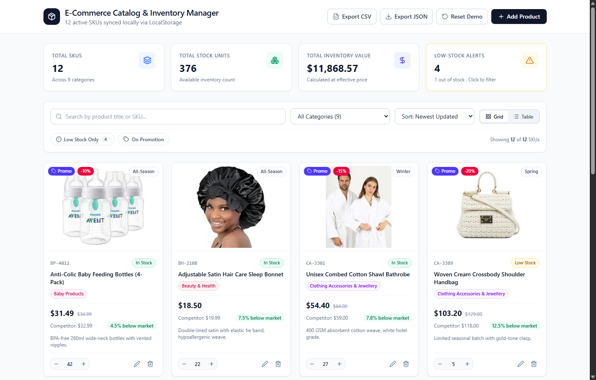
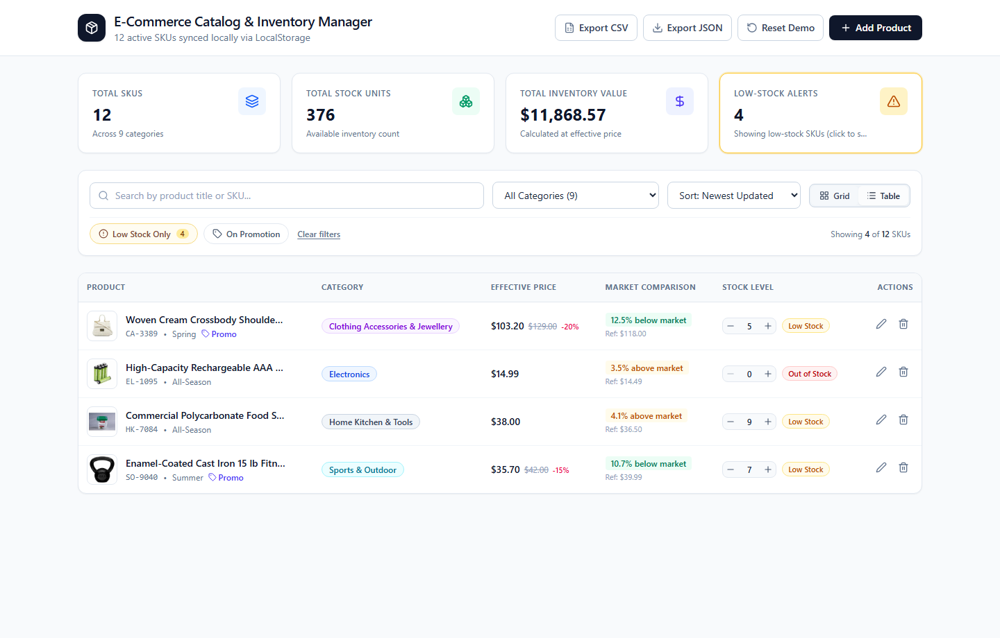
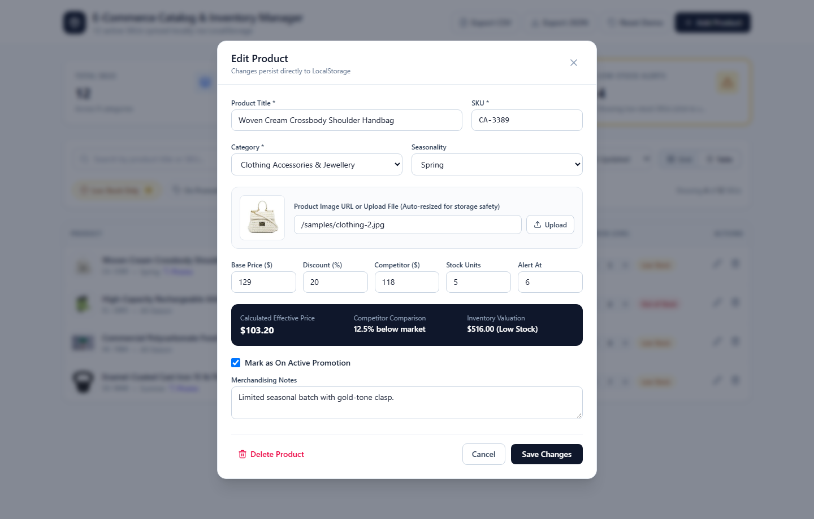
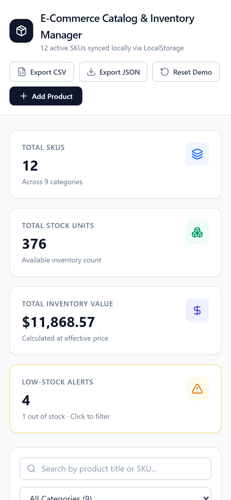

# E-Commerce Catalog & Inventory Manager

A responsive, client-side **E-Commerce Product Catalog & Inventory Manager** web application built with **React**, **Vite**, **Tailwind CSS**, and **Lucide Icons**. All catalog state and edits persist locally in the browser via `LocalStorage`, enabling zero-backend static deployment on **Netlify**, **Vercel**, or **GitHub Pages**.

---

## Key Features

- **Live Inventory KPI Summary**: Real-time calculation of **Total SKUs**, **Total Stock Units**, **Total Inventory Value** (computed from discounted effective prices), and **Low-Stock Alerts** (with out-of-stock breakdown). Clicking the **Low-Stock Alerts** KPI card toggles the low-stock filter view.
- **Dual Catalog Views (Grid & Table)**: Switch seamlessly between visual product cards and a structured inventory table featuring SKU codes, category badges across 9 fixed retail categories, effective vs. original struck-through pricing, competitor price delta badges, seasonality tags, stock status indicators, and inline `+1` / `-1` stock steppers.
- **Real-Time Search, Filtering & Sorting**: Filter by keyword (product title or SKU), 9 retail categories, **Low Stock Only** (with live count badge), and **On Promotion**, and sort by newest updated, effective price, or stock quantity.
- **Validated Add / Edit / Delete Modal**: Supports creating, editing, and confirming deletion of products with required/unique SKU validation, `0–99%` discount bounds, URL input or local image upload (canvas-compressed to `480px` max for storage safety), broken-image fallbacks, `Escape` / safe backdrop dismissal, and a live preview of calculated effective price, market comparison, and inventory valuation.
- **Resilient Persistence & Data Backup**: Gracefully recovers from corrupted `LocalStorage` entries, handles storage quota errors with inline notices, restores the 12-item starter catalog via **Reset Demo**, and exports the full catalog as **CSV** or **JSON**.
- **Responsive Design**: Adapts cleanly from desktop (`1440px+`) to tablet and mobile (`390px`) viewports with contained horizontal table scrolling and re-flowed filter controls.

---

## Screenshots

### Desktop Catalog Grid & KPI Dashboard


### Table View with Synchronized Low-Stock Filter


### Edit Product Modal & Live Pricing Calculation


### Mobile Responsive Layout (`390px`)


---

## Technologies Used

| Layer | Technology | Version |
| --- | --- | --- |
| UI Framework | React | `^19.3.1` |
| Build Tool & Dev Server | Vite (`@vitejs/plugin-react`) | `^8.3.6` |
| Styling | Tailwind CSS (`@tailwindcss/vite`) | `^4.3.5` |
| Icons | Lucide React (`lucide-react`) | `^1.73.0` |
| Linter | Oxlint | `^1.90.0` |
| Persistence | Browser `LocalStorage` API | Native |

---

## Local Setup & Scripts

```bash
# 1. Navigate to the project folder
cd week3-ecommerce-app

# 2. Install dependencies
npm install

# 3. Start the local development server
npm run dev

# 4. Run the linter
npm run lint

# 5. Build production bundle (outputs to dist/)
npm run build

# 6. Preview the production build locally
npm run preview
```

### Static Deployment (Vercel / Netlify)

Because the application runs completely client-side with `LocalStorage` persistence, it deploys directly as a static Vite site:

- **Build command:** `npm run build`
- **Publish / Output directory:** `dist`
- **Root directory (if deploying from a monorepo):** `week3-ecommerce-app`

---

## Project Structure

```text
week3-ecommerce-app/
├── docs/
│   └── screenshots/              # Desktop, table, modal, and mobile screenshots
├── public/
│   └── samples/                  # 12 starter catalog product images
├── src/
│   ├── components/
│   │   ├── EmptyState.jsx        # Zero-results / empty catalog state
│   │   ├── FilterToolbar.jsx     # Search, category, sort, view mode, and quick toggles
│   │   ├── Header.jsx            # App title, CSV/JSON export, Reset Demo, Add Product
│   │   ├── KpiSummaryStrip.jsx   # 4 real-time KPI summary cards
│   │   ├── ProductCard.jsx       # Grid card with stock stepper & quick actions
│   │   ├── ProductFormModal.jsx  # Validated CRUD modal + canvas image compression + preview
│   │   ├── ProductImage.jsx      # Image renderer with broken-URL fallback state
│   │   └── ProductTable.jsx      # Responsive scrollable table view
│   ├── constants/
│   │   ├── categories.js         # 9 retail categories, badge styles, seasonality options
│   │   └── seedData.js           # 12 starter SKUs spanning all 9 categories
│   ├── utils/
│   │   ├── export.js             # JSON and escaped CSV download helpers
│   │   ├── pricing.js            # Effective price, competitor delta, and stock status math
│   │   └── storage.js            # Safe LocalStorage parsing, validation, and saving
│   ├── App.jsx                   # Root state, filtering/sorting, notice banner, layout
│   ├── index.css                 # Tailwind CSS entry point
│   └── main.jsx                  # React root mount
├── index.html
├── package.json
├── vite.config.js
└── AI_DEVELOPMENT_LOG.md         # Detailed breakdown of AI usage per workflow phase
```

---

## AI-Assisted Development Summary

AI assistance (interactive coding assistant in the IDE) was used iteratively across all project phases and verified at every step with `oxlint`, `vite build`, and headless browser inspection. A detailed phase-by-phase breakdown is documented in [AI_DEVELOPMENT_LOG.md](AI_DEVELOPMENT_LOG.md):

1. **Planning & Schema Design**: Designed the 4-zone dashboard layout (`Header`, `KpiSummaryStrip`, `FilterToolbar`, Grid/Table catalog + CRUD modal) and structured the product schema (`sku`, `category`, `price`, `discountPercent`, `competitorPrice`, `isOnPromotion`, `seasonality`, `stock`, `lowStockThreshold`).
2. **Component Generation**: Scaffolded modular React components, Tailwind CSS v4 utility layouts, pricing/stock calculation utilities (`src/utils/pricing.js`), and seed data covering all 9 categories.
3. **Code Evaluation & Hardening**: Reviewed and tightened edge cases—adding strict modal field validation, corrupted `LocalStorage` sanitization, `QuotaExceededError` handling, client-side canvas image resizing, broken image URL fallbacks (`ProductImage.jsx`), CSV/JSON exports, and resolving `oxlint` warnings (`no-constant-binary-expression`).
4. **Debugging & Responsive Polish**: Fixed narrow-screen filter bar wrapping, bounded horizontal table scroll inside flex layouts (`min-w-0`), implemented `Escape`-key and `onMouseDown`-backdrop modal dismissal alongside session-keyed form resets so stale edited values never flash, and synchronized the **Low-Stock Alerts** KPI card click target with live `+1`/`-1` stock stepper counts.
